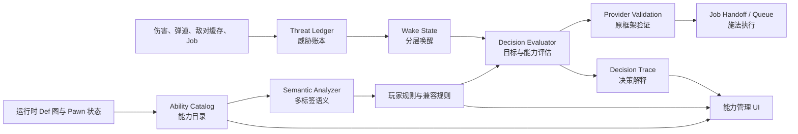
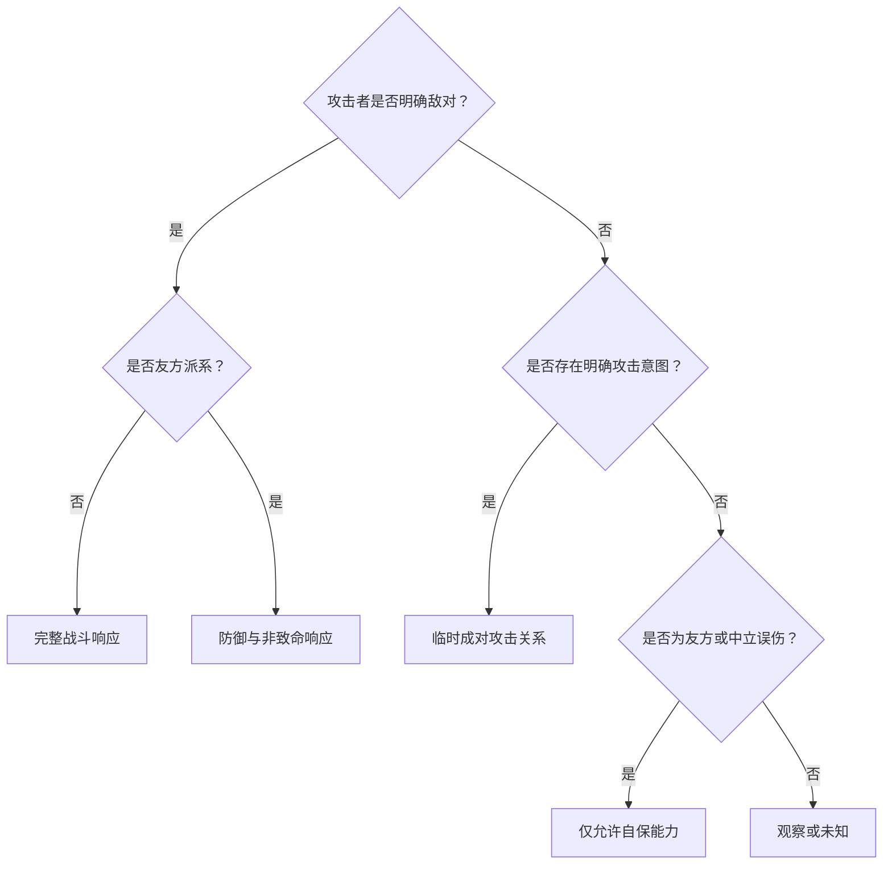
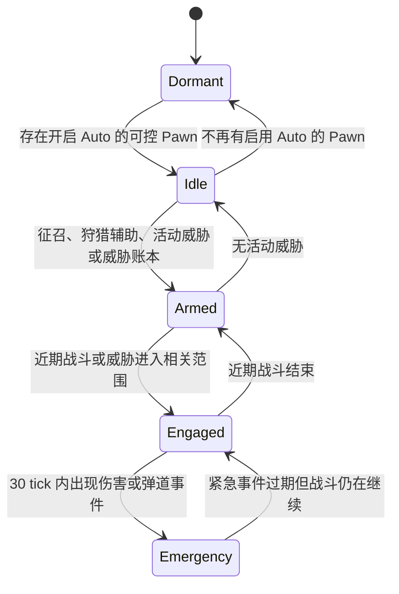
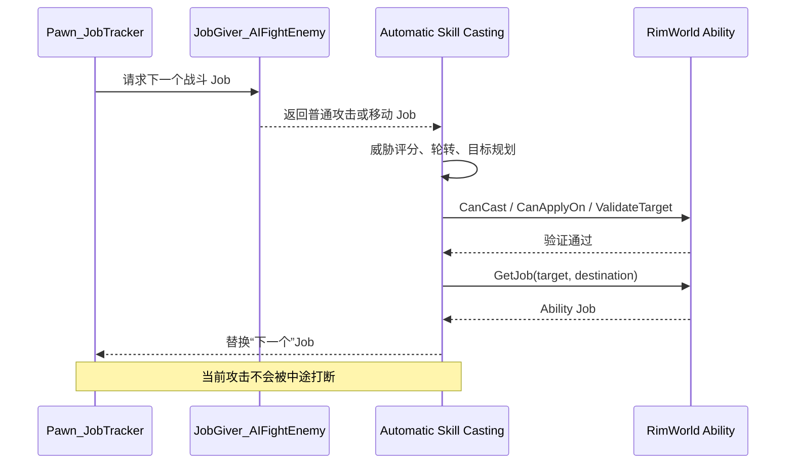

# 从“自动点技能”到战术调度器：RimWorld 全模组兼容自动施法系统的工程实现

> 作者：Mika  
> 项目：Automatic Skill Casting  
> 当前实现基线：RimWorld 1.6 / Mod v0.6.2

## 摘要

给 RimWorld 做一个“自动释放技能”的模组，表面上像是在满足条件时替玩家点击技能图标，真正实现后却会迅速演化成一个小型战术 AI 系统。

难点并不只在于“怎样找到敌人”，还包括：怎样从数百个模组中发现能力、怎样识别能力语义、怎样区分敌军攻击与友军误伤、怎样自动使用治疗和位移、怎样避免打断原版 Job、怎样让技能轮转而不抽搐，以及怎样在开放的模组生态中保持可扩展性和性能稳定。

本文以 Automatic Skill Casting 的实际开发为背景，复盘这套系统从能力扫描、威胁建模、分层唤醒、目标选择，到 Job 交接、特殊 Pawn 兼容和可解释决策的完整工程思路。文中重点不是某个具体种族或技能，而是如何在一个高度开放、运行时状态不断变化的游戏中，构建一套**保守、可验证、可扩展的自动决策系统**。

**关键词：** RimWorld、Mod、Ability、Job System、战术 AI、威胁评分、事件驱动、兼容层、可解释决策、性能优化

---

## 1. 为什么“自动施法”远比自动点击复杂

最初的需求可以浓缩为一句话：

> 找到小人拥有的技能，找到敌人，然后自动释放。

但 RimWorld 的开放性会立刻制造大量反例：

- 小人被征召，不代表地图上存在需要攻击的目标；
- 地图正在发生 Raid，也不代表这个小人应该立刻释放技能；
- 中立单位可能因为临时原因攻击玩家，但不应把整个派系视为敌人；
- 友军弹道可能误伤小人，但不能因此自动反击友军；
- 狩猎、发狂、捕食、任务强制工作和玩家指令都有不同的响应边界；
- 一个技能可能同时具有伤害、位移、控制和护盾效果；
- 同一个 `AbilityDef` 可能由普通能力容器、异变体容器或第三方框架持有；
- 直接插入施法 Job，可能与原版攻击 Job、SearchAndDestroy 或其他 JobGiver 反复抢占；
- 轮询全部 Pawn、全部目标、全部技能，会在大型模组表中快速放大为性能问题。

因此，系统不能被设计成：

```text
每隔 N tick：
    遍历所有小人
    遍历所有敌人
    遍历所有技能
    选最高分技能并强制施法
```

这条路径虽然很快能做出“看起来能动”的原型，但会同时带来误判、卡顿、技能垄断和 Job 抽搐。

> [!IMPORTANT]
> **自动施法的本质不是自动点击，而是一个受原版 Job 系统约束的战术调度器。**  
> 它需要回答的不只是“放哪个技能”，还包括“现在是否该介入”“允许介入到什么程度”“怎样不破坏当前行为”。

---

## 2. 先确定不可破坏的边界

在写评分公式之前，首先需要确定一组优先级高于“输出效率”的约束。

### 2.1 安全约束

1. 未通过原能力框架验证的目标，永远不释放；
2. 世界地图能力、多阶段选点和带确认框的能力，默认只允许手动使用；
3. 友军误伤不能触发攻击性报复；
4. 中立攻击者只建立攻击者与受害者之间的临时关系；
5. 玩家强制 Job 默认不被普通自动施法打断；
6. 当前 Ability Job 未完成时，不允许下一技能抢占；
7. 未知能力只能进入目录，不能因为名称“看起来像攻击”就直接自动释放；
8. 模组关闭或某个 Pawn 关闭 Auto 后，相关 Harmony 事件应立即快速返回。

### 2.2 当前真实执行边界

v0.6.2 的真实施法链路优先支持官方 `RimWorld.Ability` 的本地目标能力，包括大量使用官方灵能框架实现的第三方技能。

Provider 接口已经为其他能力框架保留扩展点，但未知框架、世界目标和复杂多阶段能力仍保持影子评估或手动状态。

> [!WARNING]
> “扫描到了能力”不等于“已经安全支持自动释放”。发现、分类、目标规划、框架验证和 Job 执行必须是五个独立阶段。

---

## 3. 总体架构：把不确定性分层隔离

系统最终被拆成能力目录、规则、威胁、决策、执行、状态和 UI 七个主要部分。



这套分层的核心价值是：

- 能力扫描失败，不会直接破坏 Job；
- 语义推断错误，可以由玩家规则覆盖；
- 威胁关系限制响应上限，评分再高也不能越过外交安全边界；
- 执行层仍然调用原能力的验证和 Job API；
- UI 可以解释拒绝原因，而不是只显示“没有施法”。

---

## 4. 能力发现：运行时事实比静态名单可靠

### 4.1 不维护固定模组名单

对于持续更新的模组生态，固定写死“支持哪些技能”很快会过期。能力目录应从游戏最终加载完成后的 Def 图构建，而不是从磁盘目录猜测。

每个能力条目记录：

- 来源 packageId；
- `defName` 与显示名称；
- Ability、Verb、Comp 和扩展类型；
- 目标形态、范围、半径；
- 是否需要确认、是否为世界目标、是否多阶段；
- 推断标签、风险、置信度和自动化处置建议。

### 4.2 稳定的 AbilityKey

仅使用显示名称是不可靠的。不同模组可能拥有同名技能，旧版本也可能留下 Legacy Def。

系统使用稳定键：

```text
vanilla::package.id::AbilityDefName
```

这个键同时用于：

- 玩家分类规则；
- 连招顺序；
- 预设导入导出；
- 人物能力所有权核对；
- 模组停用后的失效规则恢复。

> [!IMPORTANT]
> **能力身份必须由框架、来源包和 Def 名共同决定。**  
> 显示名称只用于 UI，不能作为存档或规则关联的主键。

### 4.3 一个容易被忽略的特殊情况：Mutant 能力容器

普通官方能力通常位于：

```csharp
pawn.abilities.AllAbilitiesForReading
```

但 Anomaly 的异变体能力可以位于：

```csharp
pawn.mutant.AllAbilitiesForReading
```

部分种族模组还会主动把异变体技能从普通 tracker 中移除，只通过 `Pawn_MutantTracker` 暴露。

因此能力枚举必须合并两个容器并去重：

```text
OwnedAbilities = Distinct(
    PawnAbilityTracker abilities
    ∪ PawnMutantTracker abilities
)
```

这次修复覆盖了 MoeLotl: Rigor Mortis 一类可控僵尸，也形成了对其他 Anomaly 可控异变体的通用兼容基础。

---

## 5. 能力语义：攻击与辅助不是单选题

单一的“攻击/辅助”分类无法描述现代 RimWorld 技能。

例如：

- 瞬移斩 = Damage + MobilitySelf；
- 拉拽 = Control + MobilityOther；
- 治疗领域 = Heal + Buff；
- 烟雾跳跃 = MobilitySelf + SmokeOrCover；
- 召唤物自爆 = Damage + Summon + AreaFriendlyFire。

因此能力使用多标签模型：

| 方向 | 主要标签 |
|---|---|
| 进攻 | `Damage`、`Control`、`Debuff`、`Summon` |
| 生存 | `Heal`、`Cleanse`、`Shield`、`SmokeOrCover` |
| 机动 | `MobilitySelf`、`MobilityOther`、`Rescue` |
| 增益与环境 | `Buff`、`Terrain` |
| 高风险 | `WorldStrategic`、多阶段、确认框、范围友伤、消耗己方单位 |

通用分析器会综合 `AbilityDef`、Verb、Comp、目标参数和命名 token 推断标签；定向兼容层负责修复那些把核心效果隐藏在自定义 Verb/Comp 内的技能。

玩家规则拥有最终决定权：

```text
玩家显式规则 > 内置兼容事实 > 通用语义推断 > 未知安全默认
```

内置兼容不会强迫玩家启用某个技能，只会提供更准确的战术事实和风险信息。

---

## 6. “敌人”不是布尔值，而是关系与响应上限

Raid 或 Incident 只适合当作提前唤醒信号，不能作为最终战斗事实。

系统实际区分以下关系：

| 威胁关系 | 典型情况 | 响应上限 |
|---|---|---|
| `ConfirmedFactionHostile` | 正式敌对派系 | 完整战斗 |
| `AggroMentalState` | 发狂单位 | 完整战斗 |
| `PredatorIntent` | 捕食者正在狩猎 | 完整战斗 |
| `TransientNeutralAggressor` | 中立单位临时主动攻击 | 防御与非致命控制 |
| `FriendlyIntentionalAggressor` | 友军因特殊机制主动攻击 | 防御与非致命控制 |
| `FriendlyAccidentalFire` | 友军误伤 | 仅自保 |
| `NeutralAccidentalFire` | 中立误伤 | 仅自保 |
| `EnvironmentalHazard` / `Unknown` | 环境或未知来源 | 仅自保或观察 |



关系判断会读取：

- `HostileTo`；
- `mindState.enemyTarget`；
- 当前 Job 的 A/B/C 目标；
- 当前 Verb 目标；
- 发狂状态；
- `PredatorHunt`；
- 最近实际伤害与弹道预警。

> [!IMPORTANT]
> **响应上限先于威胁分数。**  
> 一个友军即使价值极高、距离极近、刚造成巨大伤害，也不能因为评分高就进入致命攻击流程。

---

## 7. 威胁评分：战略价值与战术紧迫度分离

系统没有简单地把市场价值当作威胁，而是将评分拆成两部分。

### 7.1 战略威胁

战略威胁考虑：

- 目标本体市场价值；
- 武器、服装和库存价值；
- 种族或 PawnKind 的 `combatPower`；
- 射击与近战技能；
- 当前健康比例。

当前实现的核心形式为：

```text
Asset = clamp(9 × ln(1 + (MarketValue + GearValue) / 250), 0, 35)
Race  = clamp(10 × ln(1 + CombatPower / 50), 0, 25)
Skill = clamp(0.55 × (Shooting + Melee), 0, 20)
HealthFactor = clamp(0.25 + 0.75 × HealthPercent, 0.25, 1.0)
Strategic = (Asset + Race + Skill) × HealthFactor
```

对数压缩能避免极高价值装备让分数无限膨胀；健康因子则降低对濒死目标继续投入昂贵技能的倾向，同时保留 0.25 下限，防止危险目标完全消失。

### 7.2 战术紧迫度

战术紧迫度考虑：

- 8 格或 20 格内的距离压力；
- 是否明确锁定施法者；
- 当前 Verb 是否正瞄准施法者；
- 发狂或捕食状态；
- 最近累计伤害和命中次数；
- 来袭弹道；
- 敌对关系类型。

最终分数：

```text
Threat = clamp(
    Strategic × 0.62 + TacticalUrgency × 0.72,
    0,
    100
)
```

这并不是一个追求数学最优的模型，而是一个可调、可解释、在游戏语义上单调的工程模型。

### 7.3 两阶段筛选

为了避免对每一个目标执行完整评分与每一个技能的框架验证，系统使用两阶段筛选：

1. 用市场价值、combatPower、距离、攻击意图和近期事件计算 `QuickScore`；
2. 只保留最多 8 个高价值候选；
3. 对候选执行完整威胁评分；
4. 再逐个尝试当前轮转中的能力和目标。

这使复杂度从近似：

```text
全部 Pawn × 全部目标 × 全部技能 × 完整验证
```

收缩为：

```text
有限 Pawn 预算 × Top-K 目标 × 当前轮转能力
```

---

## 8. 辅助能力自动化：必须先回答“谁真的需要它”

攻击技能通常围绕敌人选择目标，辅助技能则必须区分效果类型。

### 8.1 目标需求条件

| 标签 | 触发条件 |
|---|---|
| `Heal` | 目标倒地或健康低于接近满血阈值 |
| `Cleanse` | 存在有害的非普通伤口 Hediff |
| `Rescue` | 其他友方 Pawn 倒地 |
| `MobilityOther` | 友方倒地、健康较低，或距离威胁过近 |
| `Shield` / `Buff` | 可作为主动战斗准备，但仍受威胁状态限制 |
| `SmokeOrCover` | 施法者附近或施法者与威胁之间的防御位置 |

辅助目标会根据缺失生命、倒地状态、有害 Hediff 数量、与敌人的距离等因素排序，并限制候选数量。

### 8.2 位移不是“向敌人跳”这么简单

当前单阶段地点型位移采用保守的战术落点生成：

- 目标较远时，沿威胁方向接近，但保留约 2.5 格距离；
- 目标过近时，使用由 Pawn/目标 ID 决定方向的侧向位移，避免所有人选择同一侧；
- 先在期望落点周围搜索，再回退到施法者附近；
- 最多保留 12 个候选格；
- 候选格必须可站立、未被迷雾覆盖、无人占用、位于能力范围内；
- 最终仍由 `CanApplyOn`、`ValidateTarget` 和目的地 Comp 验证。

多阶段传送、世界地图传送或需要精确二次选点的技能仍保持手动。

> [!NOTE]
> 当前位移逻辑优先解决接敌、脱离贴身和短距离战术机动。真正的工作赶路、跨地图传送和精细弹道闪避，需要独立的路径收益与 Job 恢复模型，不应混入同一套规则。

---

## 9. 分层唤醒：性能优化首先是减少“谁需要被检查”

系统没有固定频率扫描全部地图，而是为每张地图维护五级状态。



默认检查间隔：

| 状态 | 默认间隔 |
|---|---:|
| Dormant | 600 tick |
| Idle | 240 tick |
| Armed | 60 tick |
| Engaged | 15 tick |
| Emergency | 3 tick |

伤害和弹道事件可以把下一次检查提前，而不是等待固定轮询周期。

### 9.1 Pawn 决策预算

多名 Pawn 同时开启 Auto 时，系统维护轮转游标，不要求每一次评估都处理所有人。

在激烈战斗中，预算按以下目标估算：

```text
RequiredPawnBudget ≈ ceil(
    EligiblePawnCount × EvaluationInterval / CastInterval
)
```

最终预算限制为：

```text
1 ≤ Budget ≤ min(EligiblePawnCount, 8)
```

这样既能让施法间隔较短的多名 Pawn 及时获得机会，又不会在某一个 tick 内产生无上限计算峰值。

### 9.2 事件补丁也要有成本意识

伤害与弹道 Harmony 补丁在以下情况立即返回：

- 全局指挥器未开启；
- 目标 Pawn 没有开启 Auto；
- 伤害无效；
- 目标不在地图；
- 弹道唤醒功能关闭。

RimWorld 和 Unity 对象只在主线程读取，避免为了“并行优化”引入更难复现的状态竞争。

---

## 10. 最关键的流畅度问题：不要和 Job 系统抢方向盘

原型阶段最明显的问题不是技能选错，而是 Pawn 原地抽搐：普通攻击、移动和技能 Job 互相抢占，技能前摇尚未完成就被下一次决策打断。

### 10.1 错误路径：定时强制插入施法 Job

如果每到施法间隔就调用 `QueueCastingJob`，系统可能在以下时机介入：

- 武器正在 warmup；
- 连射 burst 尚未完成；
- SearchAndDestroy 正在更换接敌 Job；
- 另一个 JobGiver 刚刚在同一 tick 创建新 Job；
- 上一个 Ability Job 刚从队列消失，但能力尚未更新完成 tick。

这些情况会产生视觉上的抽搐、原地停顿和技能衔接不稳定。

### 10.2 正确路径：在原版战斗决策边界交接

常规战斗改为监听 `JobGiver_AIFightEnemy.TryGiveJob` 的结果。当原版准备返回下一次普通攻击或移动 Job 时，系统才决定是否用 `Ability.GetJob` 生成的技能 Job 替换它。



这种方式有三个重要性质：

1. 当前攻击可以自然完成；
2. 技能成为 AI 的下一项行为，而不是伪装成玩家强制指令；
3. 原版 Ability Job 继续负责热量、充能、前摇、冷却和 Comp 效果。

紧急防御和部分非战斗通道仍可使用 `QueueCastingJob`，但它们必须通过更严格的执行门。

> [!IMPORTANT]
> **不要直接调用 Ability 的效果方法绕过 Job。**  
> 正确的自动化不是“确保技能一定触发”，而是“在合法时机提交原框架能接受的 Job”。

### 10.3 完成感知的施法间隔

施法间隔不能从“决定施法”或“Job 入队”时开始计算，否则长前摇技能会提前进入下一轮。

系统优先以：

```csharp
ability.lastCastTick
```

作为真实完成锚点。若 Job 已消失但完成 tick 尚未发布，则等待一个游戏 tick 后再使用保守回退。

UI 中的间隔支持 0.0–5.0 秒、0.1 秒精度；即使设置为 0.0，也保留至少 1 tick 的技术护栏。

### 10.4 Job 抖动检测

如果另一个 JobGiver 在同一 tick 为同一 Pawn 连续启动多个 Job，自动施法会短暂让行。SearchAndDestroy 相关 Job 使用更长的抑制窗口，避免两个系统同时尝试“修正”Pawn 的行为。

---

## 11. 轮转与连招：公平性比单次最高效用更重要

如果每次都选效用最高的技能，冷却短、评分高的能力会长期垄断施法，其他十几个技能几乎没有出场机会。

系统提供两套序列：

### 11.1 普通轮转

- 只包含玩家明确标为攻击自动或辅助自动的能力；
- 以 Pawn 独立游标循环；
- 冷却、无目标或验证失败的槽位可以跳过；
- 每次决策尝试后推进游标，避免失败槽位或短冷却技能长期垄断；
- 成功施法后的下一次允许时间仍以真实完成 tick 为锚点；
- 不因为某一技能效用略高就永久重排。

### 11.2 连招序列

- 最上方为全局模板；
- 每个当前殖民地可控 Pawn 可以继承全局；
- Pawn 可以启用个人覆盖并独立排序；
- 个人连招只保存该 Pawn 真正拥有的 AbilityKey；
- 换模组或能力暂时失效时保留规则，能力恢复后可以重新关联。

> [!NOTE]
> 连招的“顺序”不是无条件强制施法。每个槽位仍需通过关系上限、目标需求、冷却、原框架验证和 Job 稳定性检查。

---

## 12. 三类定向兼容案例

通用架构能解决大部分能力，但真正困难的兼容往往来自“运行时对象被换掉”或“上游修改了 Job 语义”。

### 12.1 Rigor Mortis：可控 Pawn 与能力容器都不是常规路径

MoeLotl: Rigor Mortis 的僵尸使用 Anomaly `MutantDef`，并通过 Harmony 扩展可控异变体和征召按钮。其技能位于 `pawn.mutant.AllAbilitiesForReading`，普通能力列表还会主动移除这些条目。

解决方案不是硬编码角色名字，而是：

- 人物扫描从 `FreeColonists` 改为 `AllPawnsSpawned`；
- 接受普通殖民者、殖民地机械体和可控异变体；
- 以 `Pawn_DraftController.ShowDraftGizmo` 作为第三方可征召人物的兼容回退；
- 合并普通与 Mutant 能力容器；
- 为自定义 Verb/Comp 隐藏的五个技能补齐语义。

这使修复能够覆盖米拉·库尔，也能覆盖未来使用同类 Anomaly 机制的可控 Pawn。

### 12.2 Seraphim Viska：角色身份会在附身中迁移

Seraphim Viska 使用官方 Ability tracker，但附身后真正被玩家操控的是机械体宿主。本体可能退场，能力被转移，之后还可能从宿主显形或转移到另一个机械体。

如果 Auto 开关和个人连招只绑定原 Pawn ID，附身后就会“看起来突然失效”。

兼容层通过运行时反射查找附身、显形和宿主转移方法，在成功完成后复制：

- Auto 开关；
- 个人连招覆盖状态；
- 个人连招 AbilityKey 顺序。

与此同时，附身、换宿主、两阶段时空转移、消耗己方单位和大范围友伤技能继续保持手动安全门。

### 12.3 SearchAndDestroy：不是抢走寻敌，而是修复交接点

SearchAndDestroy 已经提供了成熟的自动寻敌逻辑，因此兼容目标不是替换它，而是保留其目标搜索并解决两个边界问题：

1. 上游可能把不可通行建筑本体作为 `Goto` 目标，导致同一 tick 重复创建无法完成的 Job；
2. 它会把战斗 Job 有效期压到 30 tick，长前摇 Ability 可能在生效前过期。

处理方式：

- 将不可通行目标重定向到附近可到达的接敌格；
- 找不到接敌格时短暂抑制重试；
- 普通攻击继续保持快速重决策；
- Ability Job 的有效期至少覆盖 `WarmupTime × 60 + 1` tick。

这是一种典型的兼容原则：**保留对方擅长的部分，只修复两个系统之间的语义缝隙。**

---

## 13. 特殊 Pawn 扫描的通用结论

对当前活动种族模组进行扫描后，可以把特殊机制归纳为四类：

| 类型 | 处理方式 |
|---|---|
| 普通玩家 Pawn / Xenotype | 官方殖民者身份直接覆盖 |
| 玩家机械体 | `IsColonyMechPlayerControlled` 覆盖 |
| Anomaly 可控异变体 | `IsColonySubhumanPlayerControlled` + Mutant 能力容器 |
| 第三方自定义征召对象 | `ShowDraftGizmo` 作为兼容回退 |

Milira、MoeLotl、Wolfein、Yuran、Maru、Koelime 等模组还广泛使用 `PawnFlyer`。飞行过程中原 Pawn 可能暂时不在地图。

系统不会在飞行载荷阶段强行把它继续视为可施法单位；落地重新 Spawn 后，人物扫描与自动调度自然恢复。这比维护“正在飞行的特殊角色名单”更符合运行时事实。

---

## 14. UI、影子模式与可解释决策

自动系统如果只能显示“开启/关闭”，玩家很难判断为什么没有施法。

能力管理 UI 因此承担三种职责。

### 14.1 配置

- 攻击自动；
- 辅助自动；
- 连招；
- 仅手动；
- 失效规则；
- 全局和个人 Pawn 配置；
- 0.0–5.0 秒施法间隔。

### 14.2 核对

UI 保存显式的 `inspectionPawn`，而不是依赖打开设置窗口后可能已经丢失的 `Find.Selector.SelectedPawns`。

选择“人物技能核对”目标后：

- 该 Pawn 拥有的能力置顶；
- 每个条目显示 AbilityKey 所有权；
- 同名或 Legacy 技能不会因为显示名称相同而误判。

### 14.3 解释

每条决策记录：

- 唤醒状态；
- 目标关系与响应上限；
- 战略分、紧迫度和总威胁；
- 轮转位置与配置来源；
- 选中的 AbilityKey；
- 拒绝数量、最终结果和原因摘要。

默认保留 128 条，可调整到 32–512 条。

影子模式只执行扫描、评分和记录，不提交施法 Job，适合验证新模组和新能力分类。

> [!IMPORTANT]
> **影子模式不是一个调试附属品，而是自动化系统的上线闸门。**  
> 先证明“会选对”，再允许“真的执行”，比出问题后回滚更便宜。

---

## 15. 预设为什么选择 `.asc.json`

预设需要满足：

- 人类可读；
- 能稳定表达字符串 AbilityKey、多标签、模式和顺序；
- 易于版本化和跨机器分享；
- 导入时可以校验 schema；
- 不依赖 RimWorld 存档内部结构。

因此使用专用扩展名：

```text
*.asc.json
```

文件包含：

- `profileFormat` 与 `schemaVersion`；
- RimWorld 和模组版本；
- 来源 packageId；
- 可选全局设置；
- AbilityKey、模式、标签覆盖、主分类、最低效用、友伤许可和连招顺序。

工程上还加入了：

- 5 MiB 文件上限；
- 10000 条规则上限；
- 合并与替换两种导入方式；
- 临时文件写入与原子替换；
- 导入前备份；
- 路径和扩展名校验。

---

## 16. 测试：验证运行时链路，而不只验证能否编译

仅通过 C# 构建不能证明 RimWorld 中的 Harmony 目标、Def、Job 和第三方模组实际可用。

项目使用隔离 QuickTest：

1. 复制当前配置到独立 savedata 目录；
2. 不修改玩家的 `ModsConfig.xml` 和存档；
3. 启动真实 RimWorld 运行时；
4. 注入仅用于测试的诊断 AbilityDef/MutantDef；
5. 导出能力目录和自检结果；
6. 达到验证边界后自动停止游戏进程。

回归项包括：

- Pawn 底部 Auto Gizmo；
- AbilityKey 所有权；
- 普通与 Mutant 能力合并；
- Rigor Mortis 可控僵尸能力；
- 轮转与个人连招；
- 位移接敌；
- 语义优先级；
- 种族兼容规则；
- SearchAndDestroy/原版战斗 Job 交接；
- 完成 tick 施法间隔锚点；
- 决策预算。

v0.6.2 的验证结果：

| 验证范围 | 结果 |
|---|---|
| Release 构建 | 0 warning / 0 error |
| Rigor Mortis + Seraphim Viska 针对性运行时回归 | 全部关键自检通过，模组异常 0 |
| 当前 RimSort 活动表 | 468 个启用模组成功加载到目录导出边界 |
| 全活动表能力目录 | 570 个能力，118 条内置兼容规则 |
| 工坊包与本地安装 | 文件数与 SHA-256 全部一致 |

---

## 17. 失败路径与得到的工程经验

| 失败路径 | 表现 | 根因 | 最终处理 |
|---|---|---|---|
| 只看 Raid/Incident | 征召待命时误施法，非 Raid 攻击又漏报 | 事件不是持续战斗事实 | 使用关系、意图、伤害、弹道和攻击目标缓存 |
| 每次选最高效用技能 | 十几个技能只反复使用一个 | 局部最优破坏长期公平性 | 完成感知轮转与显式连招 |
| 定时强制插入 Ability Job | Pawn 原地抽搐、平 A 与技能互相打断 | 多个 JobGiver 抢占同一 Pawn | 在原版战斗 Job 决策边界自然交接 |
| 从 `FreeColonists` 扫人物 | 可控僵尸、特殊机械体不出现 | 容器只代表普通殖民者 | `AllPawnsSpawned` + 可控身份与征召回退 |
| 只读取 `pawn.abilities` | Mutant 技能栏为空 | 异变体拥有独立能力容器 | 合并普通与 Mutant tracker |
| 依赖当前地图选择 | 所有技能显示“未拥有” | 设置窗口中选择上下文已经丢失 | 保存显式 inspection Pawn 与统一 AbilityKey |
| 对兼容模组全盘接管 | 自动寻敌逻辑重复、Job 更不稳定 | 没有尊重上游系统职责 | 只修复接敌格和 Ability Job 有效期 |
| 未知能力也尝试自动释放 | 多阶段、确认框和战略能力不可控 | 发现被误当成支持 | 未知与高风险能力默认 ManualOnly |

### 17.1 最重要的五条结论

1. **先建立响应边界，再优化评分。** 安全约束不能依赖分数碰巧较低；
2. **运行时行为优先于源码注释和模组名称。** 真正执行的容器、Harmony 补丁和 Job 才是事实；
3. **让原框架执行效果。** 自动系统负责选择和调度，不复制技能内部逻辑；
4. **性能优化先减少候选数量。** 分层唤醒、Top-K 和预算比微优化一个评分公式更有效；
5. **可解释性是兼容能力的一部分。** 没有拒绝原因，就无法区分冷却、目标无效、规则错误与 Job 冲突。

---

## 18. 仍可继续演进的方向

当前系统已经形成可用的官方 Ability 自动施法窄链路，但仍有明显的扩展空间。

### 18.1 更精细的位移与闪避

- 根据真实弹道走廊评估闪避收益；
- 比较原路径与技能路径的时间差；
- 为赶路位移保存和恢复原 Job 意图；
- 防止多个 Pawn 聚集到相同落点；
- 为救援位移规划“接近—施法—脱离”三阶段目标。

### 18.2 资源与连招规划

- 把热量、充能、能量和一次性资源纳入成本；
- 区分普通循环、爆发窗口和保命保留技能；
- 允许连招使用条件分支，而不只是线性顺序；
- 根据目标剩余生命避免高成本过杀。

### 18.3 Provider 扩展

- 为 VEF、AbilityUser/JecsLite 等框架实现独立 Provider；
- 让每个 Provider 明确声明支持的目标阶段和 Job 能力；
- 使用可选运行时反射，避免硬依赖未安装模组；
- 为第三方 Provider 建立统一的验证与回归契约。

### 18.4 更强的性能观测

- 记录每个唤醒状态的平均耗时；
- 统计目标筛选、框架验证和 Job 提交的成本；
- 监控 Pawn/目标/技能候选数量；
- 根据 TPS 自动收缩预算，但不改变安全语义。

---

## 结语

Automatic Skill Casting 最终解决的并不是“帮玩家按技能键”，而是在 RimWorld 的原版 AI、Job 系统和数百个第三方模组之间建立一层可控的战术调度。

这类系统最容易陷入两个极端：为了兼容而什么都尝试，或者为了安全而永远不真正执行。更有效的路线是逐层开放：

```text
先发现 → 再理解 → 只在安全边界内决策
→ 交给原框架验证 → 在自然 Job 边界执行
→ 用运行时证据回归验证
```

当能力身份、关系上限、性能预算、Job 生命周期和决策解释都成为一等公民后，“自动施法”才从一个容易抽搐的脚本，变成能够长期维护和扩展的系统。
